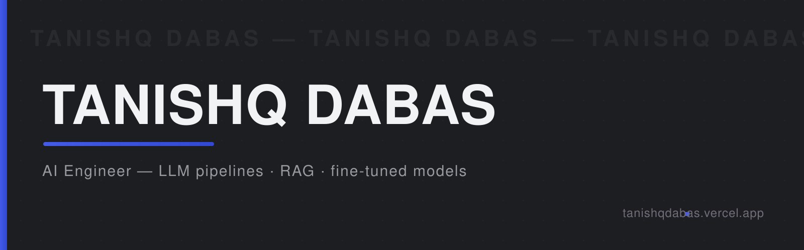

  <picture>
    
  </picture>

  
  

 

  

## about

**AI Engineer · New Delhi, India**

I build LLM systems that survive contact with production. 
Data scientist working mostly with LLMs and applied ML — RAG pipelines, fine-tuned
models, agent workflows — and I care most about the part after the notebook:
shipping systems that hold up in production.

Finishing a **B.Tech in AI and Data Science** at Guru Gobind Singh Indraprastha University
(2022–2026, **CGPA 8.5/10**) — ranked **1st in the university** in the 8th semester with a
**10/10 SGPA**.

I like problems that are messy, measurable, and consequential — the kind where being
roughly right on time beats being exactly right too late.

  

## work

**AI Software Development Intern** · TechAIVV Technologies · Jul 2026–Present

Rebuilding an AI product from the inside out — fixing a caching bug that hammered the
database on every request, and closing critical zero-day flaws that had left recruiter
data and scheduling APIs exposed.

**AI Intern** · Twenty Nine · Jun–Jul 2026

Built a manufacturing analysis system that found where production was quietly losing
efficiency, then turned those findings into ML use cases the business team could act on.

**Generative AI Intern** · Ernst & Young · Jul–Oct 2025

Built a GenAI knowledge graph over 200+ banking terms, used by 50+ people across the
org, plus a containerized LLM pipeline for document lookup that cut manual review time
by nearly half.

**AI/ML Intern** · Central Research Laboratory, Bharat Electronics Limited · Jan–Mar 2025

Fine-tuned a BERT model on 15,000+ labeled tactical communications — cutting false
positives by 30% on reconnaissance data and shaving ~20ms off inference latency.

**NLP Research Intern** · University of Delhi · Jun–Aug 2024

Researched multilingual text classification, building a pipeline that hit 82% accuracy
against a 76% monolingual baseline, backed by proper statistical testing.

  

## projects

- **[MindSync](https://github.com/tanishqdabas/Mindful-Space)** — a patented student wellbeing platform with AI-powered journaling, a risk-scoring model, and live appointment booking; running in production for 1,000+ students.
- **[DreamForge](https://github.com/tanishqdabas/DreamForge)** — chains Gemini and a diffusion model together so a single prompt turns into a full set of narrative and visual content.
- **[Fake News Detection](https://github.com/tanishqdabas/Fake-News-Detector-Streamlit-app-with-XGBoost-TF-IDF)** — benchmarked six ML architectures for detecting fake news; the ensemble beat the best single model by 3%.

  

## achievements

- **2 utility & need patents** — including MindSync, the AI student-wellbeing platform now serving 1,000+ students
- **Published research** — fake-news detection chapter with CRC Press/Routledge (2025), where the ensemble came out on top
- **IBM Data Science Professional (2026) · IBM Generative AI Professional (2025)** — backed by 13 verified Credly badges
- **10/10 SGPA · University Rank 1** — plus Highest Achiever Award, 1st in class (HSC), and 1st place in the Debate & Story Writing Competition
- **Leadership** — Peer Supporter at VIPS (confidential support for 20+ students, +15% resource utilisation) and Career Development Centre core member (5+ initiatives, 300+ attendees, 10+ industry speakers)

  

## stack

**Languages** — Python, C++

**ML / DL Frameworks** — PyTorch, TensorFlow, Scikit-learn, XGBoost, Transformers (Hugging Face), Regression, Classification, Clustering, Deep Learning, NLP, Ensemble Methods, Time Series Analysis, Dimensionality Reduction, Matplotlib, Seaborn

**GenAI and NLP** — RAG, Retrieval-Augmented Generation, LLM Fine-tuning, RLHF, Model Evaluation, Prompt Engineering, Prompt Chaining, LangChain, LangGraph, OpenAI API, Gemini API, Embeddings, Semantic Search, Text Classification, NER, Sentiment Analysis, Vector Databases (Pinecone, FAISS)

**MLOps and Deployment** — Docker, Weights & Biases, FastAPI, REST APIs, CI/CD, Experiment Tracking, Model Monitoring, Model Deployment, Data Pipelines, Git, GitHub

**Data and Statistics** — Pandas, NumPy, SciPy, Statistical Modelling, Predictive Modelling, EDA, Feature Engineering, Feature Selection, A/B Testing, Cross-validation, Hypothesis Testing, Data Wrangling, SHAP, Imbalanced Data Handling

**Databases / BI** — MySQL, MS SQL Server, Power BI

  

## contact

> [!NOTE]
> Open to AI/ML engineering roles. Best reached via [LinkedIn](https://www.linkedin.com/in/tanishqdabas) · [GitHub](https://github.com/tanishqdabas) · or the [Contact form](https://tanishqdabas.vercel.app/contact)

Notes — details not shown on the portfolio

- **Email address** (`dabastanishq@gmail.com`) — the portfolio doesn't display an email; carrying it over from your previous profile README. Confirm and I'll add it to the contact section.
- **Project repo links** — the portfolio pages don't link out to repositories; the URLs above were taken from your previous profile README.
- **Broader tool list** — C++, TensorFlow, scikit-learn, FastAPI, Docker, LangChain, LangGraph, MLflow, Pandas, Power BI and the rest now live in the stack section as provided by you.

